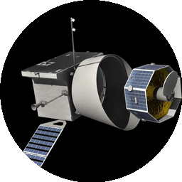
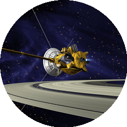
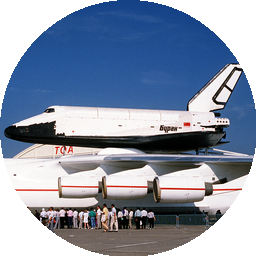
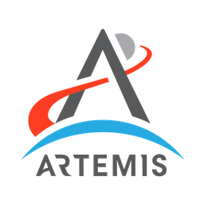
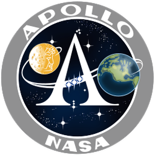
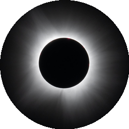
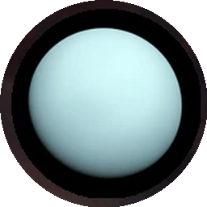
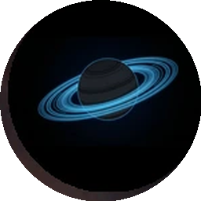
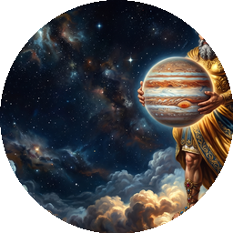

# Release names

Proposed codenames for future v2 releases, grouped by starting letter. Names are drawn from
real space missions/spacecraft. Used only as a candidate pool — the `skymap.release` skill still
confirms the actual name with the maintainer at release time (see that skill's Step 1).

Names already used: see the "Used names" table below, or `CHANGELOG.md` for the authoritative
history.

- **A** — Apollo / Artemis
- **B** — BepiColombo / Buran
- **C** — Cassini / Curiosity
- **D** — Dawn / Discovery
- **E** — Explorer / Euclid
- **G** — Galileo / Gemini / Griffin
- **H** — Hayabusa / Hubble
- **J** — Juno / James Webb
- **K** — Kepler
- **M** — Mariner / Messenger / Magellan
- **N** — New Horizons
- **O** — Orion / OSIRIS-REx
- **P** — Pioneer / Perseverance / Peregrine
- **R** — Rosetta / Ranger
- **S** — Sputnik / Skylab
- **T** — TESS / Titan
- **V** — Vostok / Voyager / Viking / Venera

## Used names

Names already assigned to a release, most recently used first. A name covers every point release
that shipped under it (`## [2.0.x:Name]` headings in `../../CHANGELOG.md`); "First released"
is the date the name's earliest *public* release reached users on Google Play (not alpha/beta,
and not a build that only got a handful of test installs), not its most recent one.

### v2

| Icon | Name | First released | Mission |
|---|---|---|---|
|  | **BepiColombo** | _unreleased (2.4.0 beta)_ | [BepiColombo](https://en.wikipedia.org/wiki/BepiColombo) — the ESA/JAXA spacecraft that reached Mercury in November 2026, after an eight-year journey, to study the planet closest to the Sun. |
|  | **Cassini** | 2026-11-04 (2.3.0) | [Cassini–Huygens](https://en.wikipedia.org/wiki/Cassini%E2%80%93Huygens) — the NASA/ESA/ASI spacecraft that orbited Saturn from 2004 to 2017, studying its rings and moons and delivering the Huygens probe to Titan. |
|  | **Buran** | 2026-10-21 (2.2.0) | [Buran](https://en.wikipedia.org/wiki/Buran_(spacecraft)) — the Soviet Union's reusable orbital spacecraft, which flew its only, uncrewed, orbital mission in 1988. |
|  | **Artemis** | 2026-09-30 (2.1.2) | [Artemis program](https://en.wikipedia.org/wiki/Artemis_program) — NASA's program to return humans to the Moon and establish a sustained lunar presence. |
|  | **Apollo** | 2026-09-05 (2.0.2) | [Apollo program](https://en.wikipedia.org/wiki/Apollo_program) — NASA's 1961–1972 program that landed the first crewed missions on the Moon. |

Hannah and Louise (the earliest 2.0.0 pre-release betas, before the mission-name convention was
adopted) are omitted here — they were pre-release names, not a shipped release identity.

### iOS

iOS has its own version line, starting at 2.0.0 because it trails the latest Android release in
features. It uses the same naming convention, but its names are independent of Android's for the
first two releases; after those we will try to align them with Android's.

The version shown in the app is "`<version>:<name>`" (e.g. `2.0.0:GDC`), like Android's
`versionName`. Apple limits `CFBundleShortVersionString` to digits and periods, so the name lives
in the `SkyMapVersionName` Info.plist key, built from `MARKETING_VERSION` and `SKYMAP_RELEASE_NAME`
in `ios/SkyMap/project.yml`.

| Icon | Name | First released | Subject |
|---|---|---|---|
|  | **Izzie** | 2026-11-18 (2.1.0) | Ginger |
|  | **GDC** | 2026-11-07 (2.0.0) | Rosie |

### v1

v1 predates the mission-name convention entirely — its names are mostly solar-system bodies
(in outward order from the Sun) plus a couple of comets, not missions.

| Icon | Name | First released | Subject |
|---|---|---|---|
|  | **Eclipse** | 2026-08-09 (1.18.0) | [Eclipse](https://en.wikipedia.org/wiki/Eclipse) — when one astronomical object is temporarily obscured by another passing between it and the observer or its light source. |
|  | **Neptune** | 2026-07-29 (1.17.1) | [Neptune](https://en.wikipedia.org/wiki/Neptune) — the eighth and outermost known planet of the Solar System. |
|  | **Caelus** | 2026-07-07 (1.16.1) | [Caelus](https://en.wikipedia.org/wiki/Caelus) — the primordial Roman god of the sky, the Roman-mythology counterpart to Uranus. |
|  | **Saturn** | 2026-06-11 (1.15.5) | [Saturn](https://en.wikipedia.org/wiki/Saturn) — the sixth planet from the Sun, known for its prominent ring system. |
|  | **Jupiter** | 2026-05-04 (1.14.2) | [Jupiter](https://en.wikipedia.org/wiki/Jupiter) — the fifth planet from the Sun and the largest in the Solar System. |
|  | **Mars** | 2026-04-12 (1.13.3) | [Mars](https://en.wikipedia.org/wiki/Mars) — the fourth planet from the Sun, known as the "Red Planet." |
|  | **Earth** | 2026-03-24 (1.12.3) | [Earth](https://en.wikipedia.org/wiki/Earth) — the third planet from the Sun and the only known astronomical object to harbor life. |
|  | **Venus** | 2026-02-04 (1.11.0) | [Venus](https://en.wikipedia.org/wiki/Venus) — the second planet from the Sun, similar in size to Earth but with a runaway-greenhouse atmosphere. |
| — | **Mercury** | 2026-01-20 (1.10.10) | [Mercury](https://en.wikipedia.org/wiki/Mercury_(planet)) — the smallest planet in the Solar System and the closest to the Sun. |
| — | **Comet Leonard** | 2021-12-21 (1.10.0) | [C/2021 A1 (Leonard)](https://en.wikipedia.org/wiki/C/2021_A1_(Leonard)) — a long-period comet discovered in January 2021, the brightest comet of that year. |
| — | **Neowise** | 2020-07-18 (1.9.4) | [C/2020 F3 (NEOWISE)](https://en.wikipedia.org/wiki/C/2020_F3_(NEOWISE)) — a long-period comet discovered in March 2020 that became easily visible to the naked eye. |
|  | **1.0** | c. 2009-02 (best guess) | Original release, as **Google Sky Map** — this predates the app's git history (which starts 2012) and the naming convention entirely, so it has no mission name, just a version number. Date is a best guess based on Google Sky Map's public launch around the T-Mobile G1's UK debut in early 2009; not verified against a primary source. |

### v1 release history

Every v1 release that reached users and has no name, newest first. Named releases are in the table
above. The dates are the first day a build was on Google Play (1.6.4 and earlier predate the
Play Console's records, so those are from other sources). Builds that only reached testers are
left out (for example 1.10.5–1.10.8, 1.13.4, 1.15.0 and 1.16.0), as are the CHANGELOG-only entries
that never shipped (1.10.11 and 1.12.0).

| Version | Date | Notes |
|---|---|---|
| 1.10.9 | 2025-01-10 | CHANGELOG says 2025-01-27, which is wrong |
| 1.10.4 | 2024-11-29 | Gradual rollout from 2024-11-06; CHANGELOG says 2024-11-30 |
| 1.10.3 | 2024-05-01 |  |
| 1.10.2 | 2024-03-01 |  |
| 1.10.0 | 2021-12-21 | Comet Leonard (see above) |
| 1.9.6 | 2020-12-14 |  |
| 1.9.5 | 2020-09-17 | CHANGELOG says 2020-09-23 |
| 1.9.4 | 2020-07-18 | Neowise (see above) |
| 1.9.3-P | 2018-09-03 |  |
| 1.9.3 | 2018-08-21 |  |
| 1.9.2 | 2016-09-27 |  |
| 1.9.1 | 2016-09-06 |  |
| 1.9.0b | 2016-07-12 |  |
| 1.9.0 | 2016-07-10 |  |
| 1.8.6b | 2016-06-11 |  |
| 1.8.6 | 2016-06-10 |  |
| 1.8.5 | 2016-05-22 |  |
| 1.8.4.1 | 2016-04-27 |  |
| 1.8.4 | 2016-04-26 |  |
| 1.8.3 | 2016-04-03 |  |
| 1.8.2 | 2016-03-08 |  |
| 1.8.1 | 2016-03-08 |  |
| 1.7.1 | 2016-03-08 |  |
| 1.8.0 | 2016-02-26 |  |
| 1.7.0 | 2016-02-23 |  |
| 1.6.5 | 2016-02-22 |  |
| 1.6.4 | 2011-08-31 |  |
| 1.6.3 | 2011-08-24 |  |
| 1.6.1 | 2010-12-24 |  |
| 1.6 | 2010-11-18 |  |
| 1.5.2 | 2010-06-18 |  |
| 1.5.1 | 2010-04-27 |  |
| 1.5 | 2010-04-23 |  |
| 1.4 | 2010-03-18 | Earliest version with a recorded date |
